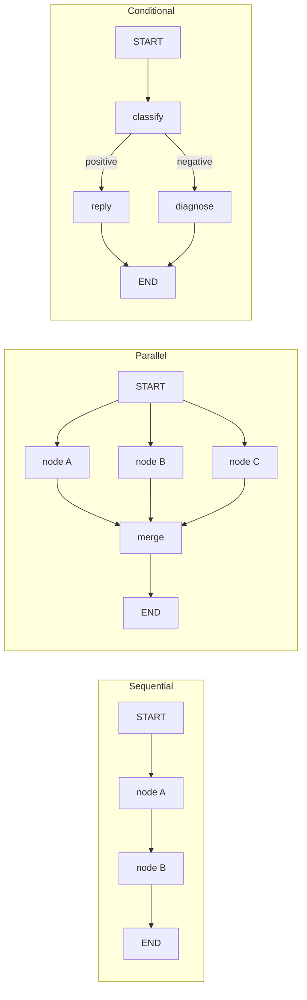
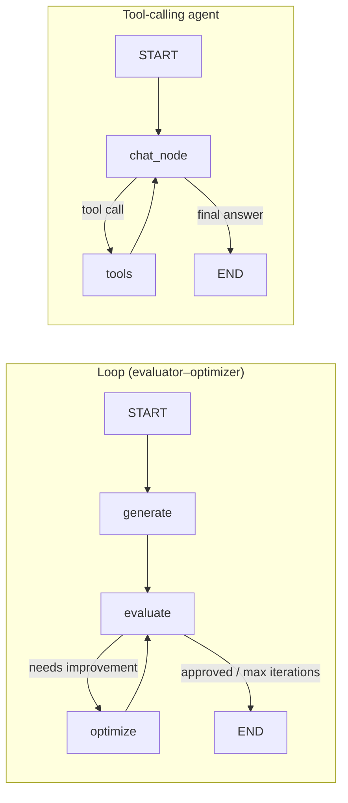

# LangGraph Tutorial

A hands-on, step-by-step walkthrough of [LangGraph](https://github.com/langchain-ai/langgraph), from a two-node graph with no LLM at all up to tool-calling agents, RAG, MCP integration, human-in-the-loop approval and subgraphs.

Each notebook introduces **one new idea** on top of the previous one, using a small, concrete example (a BMI calculator, a cricket stats workflow, an essay grader, a tweet generator, a stock-trading bot…), so you can see exactly what each LangGraph feature does before combining them.

---

## What you'll learn

| # | File | Concept | Example |
|---|------|---------|---------|
| 0 | `0_test_installation.ipynb` | Sanity check | Import `StateGraph` to confirm the install works |
| 1 | `1_bmi_workflow.ipynb` | **Sequential graph** — `TypedDict` state, nodes, edges, `START`/`END`, `compile()`, `invoke()`, Mermaid visualisation | Compute BMI → label the category (no LLM) |
| 2 | `2_simple_llm_workflow.ipynb` | **LLM inside a node** | Single-node question-answering workflow |
| 3 | `3_prompt_chaining.ipynb` | **Prompt chaining** — one LLM output feeds the next | Blog title → outline → full blog post |
| 4 | `4_batsman_workflow.ipynb` | **Parallel branches** — fan-out / fan-in, nodes returning partial state | Strike rate, balls-per-boundary and boundary % computed in parallel, then summarised |
| 5 | `5_UPSC_essay_workflow.ipynb` | **Parallel LLM calls + reducers + structured output** — `Annotated[list, operator.add]`, Pydantic schemas | Grade an essay on language, analysis and clarity in parallel, then aggregate feedback and average score |
| 6 | `6_quadratic_equation_workflow.ipynb` | **Conditional edges** — routing on state | Discriminant decides between real, repeated or no real roots |
| 7 | `7_review_reply_workflow.ipynb` | **LLM-driven routing** — classify, then branch | Positive review → thank-you; negative review → diagnose (issue type, tone, urgency) → tailored reply |
| 8 | `8_X_post_generator.ipynb` | **Loops / evaluator–optimizer pattern** — cycles with an iteration cap | Generate a tweet → critic LLM evaluates → optimiser rewrites until approved |
| 9 | `9_basic_chatbot.ipynb` | **Message state** — `add_messages` reducer | Minimal chatbot |
| 10 | `10_persistence.ipynb` | **Persistence & checkpointers** — threads, `get_state`, state history, **time travel**, `update_state`, **fault tolerance** (resume after a crash) | Joke generator + a deliberately "crashing" workflow |
| 11 | `11_tools.ipynb` | **Tool calling** — `bind_tools`, `ToolNode`, `tools_condition`, the agent loop | Chatbot with web search (DuckDuckGo), a calculator and a live stock-price tool |
| 12 | `12_mcp.py` | **MCP (Model Context Protocol)** — load tools from MCP servers with `langchain-mcp-adapters` (stdio + streamable HTTP), async graphs | Agent that uses a local math server and a remote expense-tracker server |
| 13 | `13_rag.ipynb` | **Agentic RAG** — retrieval exposed as a tool | PDF → chunks → OpenAI embeddings → FAISS → `rag_tool` used by the agent |
| 14 | `14_hitl.ipynb` | **Human-in-the-loop** — `interrupt()` and `Command(resume=...)` | Pause before the model answers and ask a human to approve |
| 15 | `15_subgraphs.ipynb` | **Subgraphs with a different state** — call a compiled graph from inside a node | Answer a question in English, then a translation subgraph renders it in Hindi |
| 15 | `15_subgraph_shared.ipynb` | **Subgraphs with shared state** — add a compiled graph directly as a node | Same English → Hindi pipeline, sharing the parent's state schema |

### Standalone scripts

| File | What it shows |
|------|---------------|
| `chatbot_without_hitl.py` | CLI stock-trading assistant with two tools (`get_stock_price`, a mock `purchase_stock`) and in-memory conversation memory. The agent can "buy" shares without asking anyone. |
| `chatbot_with_hitl.py` | The same assistant, but `purchase_stock` calls `interrupt()` so every purchase waits for a human `yes`/`no` before it goes through. Run the two side by side to see why HITL matters for actions with consequences. |

---

## The patterns at a glance





---

## Getting started

### Prerequisites

- Python 3.10+
- An [OpenAI API key](https://platform.openai.com/api-keys)
- Jupyter (Notebook, Lab or VS Code)

### Installation

```bash
git clone https://github.com/aayushbishtt/langgraph-tutorial.git
cd langgraph-tutorial

python -m venv .venv
source .venv/bin/activate        # Windows: .venv\Scripts\activate

pip install -r requirements.txt
```

Some later lessons need a few extra packages that aren't in `requirements.txt`:

```bash
# tools (11), RAG (13) and MCP (12)
pip install langchain-community duckduckgo-search faiss-cpu pypdf langchain-mcp-adapters
```

### Environment variables

Create a `.env` file in the project root:

```env
OPENAI_API_KEY=sk-...
```

Every notebook calls `load_dotenv()`, so the key is picked up automatically.

### Run

Open the notebooks in order:

```bash
jupyter notebook
```

Or run the CLI chatbots:

```bash
python chatbot_without_hitl.py
python chatbot_with_hitl.py      # try: "buy 10 shares of AAPL"
```

---

## Lesson-specific notes

- **`11_tools.ipynb`, `chatbot_*.py`** — the stock-price tool uses the [Alpha Vantage](https://www.alphavantage.co/support/#api-key) API. Get a free key and put it in the URL inside `get_stock_price` (the free tier is rate-limited).
- **`12_mcp.py`** — expects a local MCP math server; change the path in the `"arith"` entry of `MultiServerMCPClient` to point at your own server script. The `"expense"` entry points to a remote FastMCP server and can be swapped for any MCP server you have access to.
- **`13_rag.ipynb`** — loads a PDF called `intro-to-ml.pdf` that isn't included in the repo. Drop any PDF into the project folder and update the filename in `PyPDFLoader(...)`.
- **`10_persistence.ipynb` (fault tolerance)** — step 2 deliberately sleeps; interrupt the kernel with the stop button while it runs, then run the next cell to watch the graph resume from the last checkpoint.
- **`14_hitl.ipynb`** — the approval prompt uses `input()`, so run it in an environment where interactive input works.

---

## Project structure

```
langgraph-tutorial/
├── 0_test_installation.ipynb
├── 1_bmi_workflow.ipynb
├── 2_simple_llm_workflow.ipynb
├── 3_prompt_chaining.ipynb
├── 4_batsman_workflow.ipynb
├── 5_UPSC_essay_workflow.ipynb
├── 6_quadratic_equation_workflow.ipynb
├── 7_review_reply_workflow.ipynb
├── 8_X_post_generator.ipynb
├── 9_basic_chatbot.ipynb
├── 10_persistence.ipynb
├── 11_tools.ipynb
├── 12_mcp.py
├── 13_rag.ipynb
├── 14_hitl.ipynb
├── 15_subgraphs.ipynb
├── 15_subgraph_shared.ipynb
├── chatbot_without_hitl.py
├── chatbot_with_hitl.py
└── requirements.txt
```

## Tech stack

- **LangGraph** 0.6 — graph orchestration, checkpointing, interrupts, prebuilt `ToolNode`
- **LangChain** 0.3 + **langchain-openai** — chat models, embeddings, tools, structured output
- **OpenAI** models (`gpt-4o-mini`, `gpt-4o`, `gpt-4.1-mini`, …)
- **Pydantic** — structured LLM outputs
- **FAISS** — vector store for RAG
- **MCP** via `langchain-mcp-adapters`

---

## Author

**Aayush Bisht** — [Portfolio](https://aayushbishtt.github.io/) · [GitHub](https://github.com/aayushbishtt)

If this helped you learn LangGraph, consider giving the repo a ⭐.
